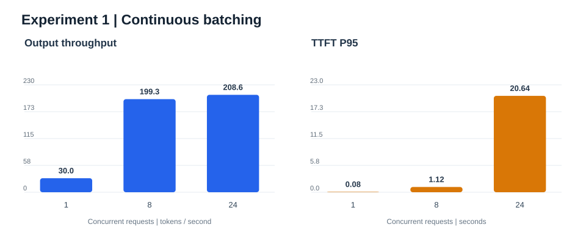
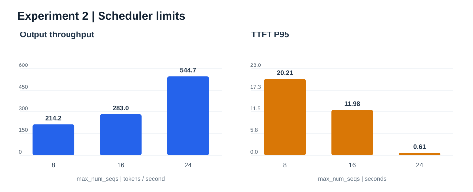
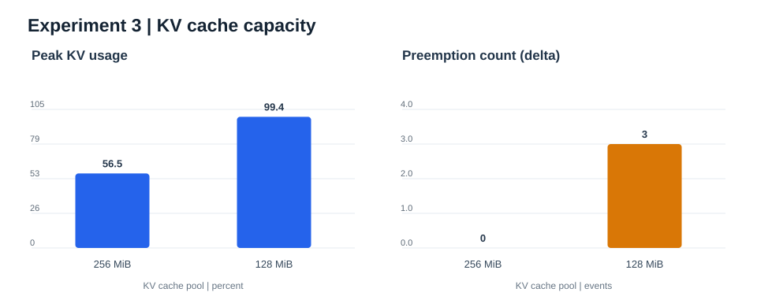
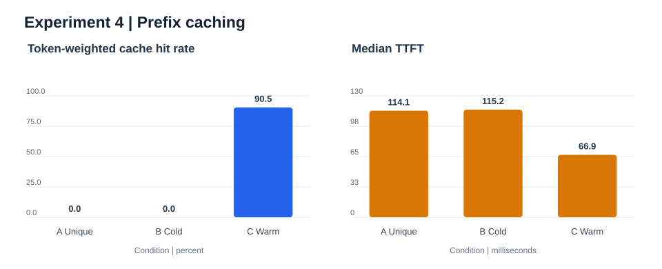

# vLLM Inference & KV Cache Monitoring

Reproducible experiments on **continuous batching, scheduler concurrency, KV cache capacity, and prefix caching** in LLM serving.

## Experiment setup

| Component | Configuration |
|---|---|
| GPU | NVIDIA Tesla T4  |
| Model | `Qwen/Qwen2.5-0.5B-Instruct` |
| Serving engine | vLLM 0.34.0 |
| Precision | FP16 (`--dtype half`) |
| Max model length | 1,024 tokens |
| API | OpenAI-compatible streaming chat completions |
| Metrics | vLLM Prometheus endpoint (`/metrics`) |
| Output | Summary CSVs, per-request results, time-series traces, comparative plots |

> **Data provenance:** All numbers in this README come from the **uploaded latest experiment CSVs**, rather than older measurements discussed during development. These are separate executions; do not combine their values. Each condition is a limited-run benchmark, not a statistically established production result.

## 1. Continuous batching

**Configuration:** `max_num_seqs=8`, 256 MiB KV cache pool; concurrent requests **1 / 8 / 24**.



| Concurrent requests | Throughput (output tok/s) | TTFT P95 (ms) | Mean chunk gap (ms) | Peak running | Peak waiting | Failed |
|---:|---:|---:|---:|---:|---:|---:|
| 1 | 29.97 | 82.76 | 33.16 | 1 | 0 | 0 |
| 8 | 199.31 | 1,122.37 | 35.30 | 8 | 0 | 0 |
| 24 | 208.56 | 20,637.09 | 37.75 | 8 | 16 | 0 |

**Observation:** Throughput increased strongly from 1 to 8 concurrent requests, but largely plateaued at 24 requests. With `max_num_seqs=8`, peak waiting reached 16 and tail TTFT became much worse. The single-request P95 is **one sample**, so it should not be treated as a reliable tail-latency estimate.

Source: [01_batching_summary.csv](results/01_batching_summary.csv)

## 2. Scheduler concurrency limit

**Configuration:** 24 concurrent requests, 256 MiB KV cache pool; `max_num_seqs = 8 / 16 / 24`.



| max_num_seqs | Throughput (output tok/s) | TTFT P95 (ms) | Mean chunk gap (ms) | Peak running | Peak waiting | Preemptions |
|---:|---:|---:|---:|---:|---:|---:|
| 8 | 214.20 | 20,206.17 | 36.73 | 8 | 16 | 0 |
| 16 | 282.98 | 11,981.84 | 41.46 | 16 | 13 | 0 |
| 24 | 544.68 | 608.81 | 42.22 | 24 | 14 | 0 |

**Observation:** Allowing more simultaneously scheduled sequences improved throughput and substantially reduced TTFT P95 in this workload. The **peak waiting** metric is a time-series maximum, so a temporary waiting spike may appear even when `max_num_seqs=24`; it does **not** mean 14 requests waited for the entire run.

A larger `max_num_seqs` is not universally better: benefits depend on workload, GPU limits, token-budget limits, and available KV cache.

Source: [02_scheduler_summary.csv](results/02_scheduler_summary.csv)

## 3. KV cache pool capacity

**Configuration:** 24 concurrent requests, `max_num_seqs=24`; KV pool **256 / 128 MiB**.



| KV pool | Throughput (output tok/s) | TTFT P95 (ms) | Peak KV use | Peak waiting | Preemptions | Failed |
|---:|---:|---:|---:|---:|---:|---:|
| 256 MiB | 495.26 | 465.69 | 56.47% | 6 | 0 | 0 |
| 128 MiB | 437.39 | 532.89 | 99.41% | 14 | **3** | 0 |

**Observation:** Reducing the KV pool increased occupancy and, in this run, coincided with **three preemptions**, higher peak waiting, and lower throughput. This is a more direct example of KV capacity pressure than the earlier run, in which no preemptions were observed.

**Important:** The run stopped after detecting preemptions at 128 MiB, so **96 MiB was not measured in this uploaded CSV**. We do not invent or blend a 96 MiB row from another session. KV utilization is a proportion of the configured pool, not HBM bandwidth utilization.

Source: [03_kv_capacity_summary.csv](results/03_kv_capacity_summary.csv)

## 4. Prefix caching: Unique vs Cold vs Warm

**Configuration:** Prefix caching enabled, sequential A/B/C requests for **8 rounds**, 256 MiB KV pool, `max_num_seqs=8`.

- **A — Unique:** Distinct document prefix (cache miss control)
- **B — Cold:** First request using a new shared document prefix
- **C — Warm:** Follow-up request reusing that document prefix



| Condition | Requests (success) | Median TTFT (ms) | Mean TTFT (ms) | Cache hit tokens | Query tokens | Token-weighted hit rate |
|---|---:|---:|---:|---:|---:|---:|
| A Unique | 8 / 8 | 114.08 | 116.06 | 0 | 4,522 | 0.00% |
| B Cold | 8 / 8 | 115.22 | 104.53 | 0 | 4,525 | 0.00% |
| C Warm | 8 / 8 | **66.89** | 75.56 | **4,096** | 4,525 | **90.52%** |

**Observation:** Warm prefix reuse achieved a **90.52% token-weighted cache hit rate**, while median TTFT was approximately **41.9% lower** than Cold (115.22 → 66.89 ms). The benefit varied by round; this is an observed association under the experiment settings, not a guaranteed speedup on every request.

Hit rate is calculated over queried **tokens**, not over the percentage of requests with a hit. A shared prefix can be reused even when the final user question differs.

Source: [04_prefix_summary.csv](results/04_prefix_summary.csv)

## Key findings

1. **Batching throughput vs latency:** Higher concurrency improves aggregate throughput until the serving/scheduling limit is reached. Queueing can sharply degrade tail TTFT.
2. **Scheduler is an independent limit:** `max_num_seqs` controls concurrent scheduled sequences, but is only one of several serving constraints.
3. **KV capacity can cause pressure:** At 128 MiB, this run recorded **3 preemptions**, versus none at 256 MiB.
4. **Prefix cache reuse is measurable:** Warm-prefix requests recorded 90.52% token-weighted hits and lower median TTFT than Cold in this experiment.

## Measurement notes and limitations

- **TTFT** is measured from the client request start to the first nonempty streamed content chunk. It includes network/API, queueing, and model effects.
- **Mean chunk gap** is the average spacing between **streamed text chunks**; it is **not guaranteed to equal true token-by-token ITL**.
- **Throughput** is output tokens per second as determined by generated-token metrics and elapsed wall time.
- **Peak waiting** and **peak KV usage** are sampled time-series maxima, not persistent states.
- Prefix cache hits are token counters; rates use total hits / total queries.
- Runs have limited repetition and may vary with GPU conditions, sampling frequency, warmup, or server settings. No statistical significance is claimed.
- Model setup and source code are in [scripts/](scripts/); scripts have not yet been independently revalidated on a separate T4 runtime.

## Files and reproduction

```text
01-vllm-inference-monitoring/
├── README.md
├── scripts/
│   ├── README.md
│   ├── common.py
│   ├── 01_continuous_batching.py
│   ├── 02_scheduler_limits.py
│   ├── 03_kv_cache_capacity.py
│   └── 04_prefix_caching.py
├── results/
│   ├── 01_batching_summary.csv
│   ├── 02_scheduler_summary.csv
│   ├── 03_kv_capacity_summary.csv
│   └── 04_prefix_summary.csv
└── figures/
    ├── 01_batching.svg
    ├── 02_scheduler.svg
    ├── 03_kv_capacity.svg
    └── 04_prefix_caching.svg
```

Run only on a compatible NVIDIA GPU environment with vLLM dependencies installed. Execute the scripts **sequentially** (they manage and restart the local server when changing configurations):

```bash
python scripts/01_continuous_batching.py
python scripts/02_scheduler_limits.py
python scripts/03_kv_cache_capacity.py
python scripts/04_prefix_caching.py
```

These results illustrate the **trade-offs among throughput, tail latency, scheduler admission, KV memory pressure, and prefix reuse** in a small-model serving workload.
