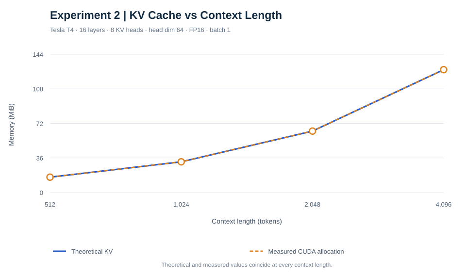
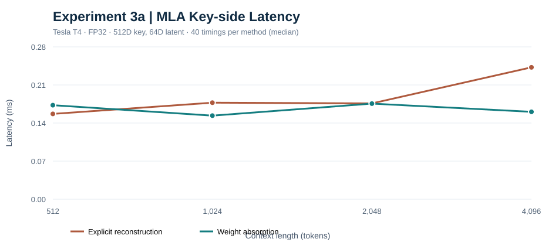
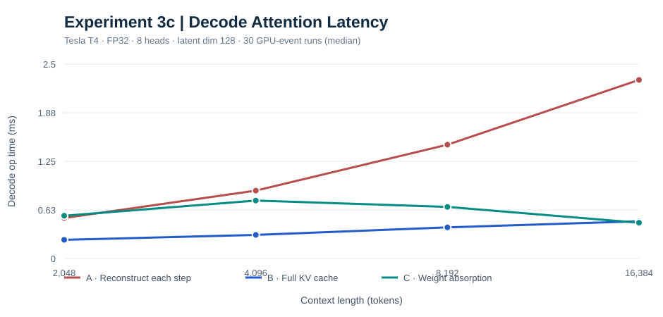
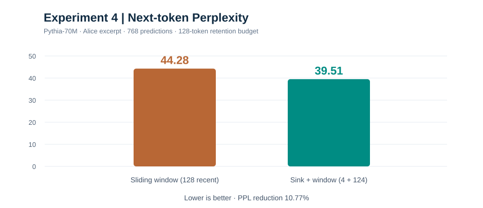

# Attention Architecture & KV Cache Experiments

Empirical studies of **KV cache growth, MLA weight absorption, and attention-sink cache retention** on aTesla T4.

Building on [01. vLLM Inference & KV Cache Monitoring](../01-vllm-inference-monitoring/), these experiments examine **where KV memory comes from**, **how equivalent Attention operations can be rearranged**, and **what happens to next-token prediction when old KV entries are evicted**.

> **Results provenance:** This README reports **observations from the Colab outputs shared during the experiments** (21 Nov 2026). Figures are **redrawn from the displayed Colab measurements** to provide consistent presentation across experiments; they are not the original Colab PNG screenshots or raw CSVs. The actual Colab CSV files have **not yet been committed**. The source scripts are available in [scripts/](scripts/). These are limited runs, not statistically established production benchmarks.

## Experiment setup

| Component | Configuration |
|---|---|
| Environment | Google Colab, NVIDIA Tesla T4 |
| Python | 3.13.16 |
| PyTorch | 2.14.0+cu130 |
| CUDA | 13.0 |
| vLLM | 0.34.0 installed (not used for the synthetic PyTorch kernels or Pythia evaluation) |
| Transformers | 5.2.1 (Experiment 4) |
| Experiment 2 | FP16, synthetic KV tensors |
| Experiment 3 | FP32, synthetic attention matrices and a learned synthetic lookup task |
| Experiment 4 | FP32, `EleutherAI/pythia-70m-deduped`, local Alice excerpt |
| Reported metrics | KV payload / allocation, numerical error, GPU-event latency, synthetic task accuracy, NLL and PPL |

## 2. Context length vs KV cache memory

**Question:** Does KV payload grow linearly as the retained context gets longer?

**Configuration:** 16 layers, 8 KV heads, head dimension 64, batch size 1, FP16; context lengths of 512 / 1,024 / 2,048 / 4,096 tokens. The script allocates separate K and V tensors on the T4 and measures their CUDA allocation delta.

```text
KV_bytes = 2 × layers × batch × context_tokens
           × kv_heads × head_dim × bytes_per_element
```



| Context tokens | Theoretical KV (MiB) | Tensor payload (MiB) | Measured CUDA allocated delta (MiB) |
|---:|---:|---:|---:|
| 512 | 16.0 | 16.0 | 16.0 |
| 1,024 | 32.0 | 32.0 | 32.0 |
| 2,048 | 64.0 | 64.0 | 64.0 |
| 4,096 | 128.0 | 128.0 | 128.0 |

**Observation:** Doubling retained token count doubled the K/V tensor bytes. All four measured allocation deltas matched the calculated payload sizes in this isolated setup.

**Interpretation:** At these dimensions, one additional cached token costs **32 KiB** across all 16 layers. This is **not** total vLLM memory: model weights, CUDA allocator reservation, PagedAttention metadata, and other runtime overhead are excluded.

**Run:** `python scripts/02_context_length_sweep.py`

## 3. MLA weight absorption

The experiment isolates the *content* path of MLA. Its core property is that moving a fixed up-projection from the cached key side to the current query side preserves the mathematical attention scores:

```text
Explicit:  score = qᵀ (W_up_K c)
Absorbed:  score = ((W_up_K)ᵀ q)ᵀ c
```

This is a **change in computation order**, not a claim that training a low-rank model improves task accuracy.

### 3a. Key-only numerical equivalence and latency

**Configuration:** 512-dimensional keys, 64-dimensional KV latent, FP32, 512–4,096 cached tokens; 10 warmup and 40 timed repetitions per implementation.

| Context tokens | Explicit (ms) | Absorbed (ms) | Explicit / Absorbed |
|---:|---:|---:|---:|
| 512 | 0.1568 | 0.1728 | 0.91× |
| 1,024 | 0.1774 | 0.1536 | 1.16× |
| 2,048 | 0.1761 | 0.1757 | 1.00× |
| 4,096 | 0.2424 | 0.1606 | 1.51× |



**Observation:** Max attention-score absolute error was on the order of `1e-6`. The absorbed path was faster at 4,096 tokens in this run, but **not** at every shorter length. The 64D latent represents 1 MiB at 4,096 tokens versus 8 MiB for an explicitly materialized 512D *key* (FP32); this is a **representation-size comparison**, not a complete MLA KV-cache measurement.

**Run:** `python scripts/03_mla_weight_absorption.py`

### 3b. Does weight absorption change prediction accuracy?

**Task:** A small trained key→value retrieval classifier. The same model weights and the same held-out 4,096 samples were evaluated with explicit and absorbed key computations.

| Metric | Explicit | Absorbed |
|---|---:|---:|
| Held-out classification accuracy | 100.0000% | 100.0000% |
| Cross-entropy | 0.000464 | 0.000464 |
| Prediction disagreements | \- | **0 / 4,096** |

- Maximum attention-score error: **2.861 × 10⁻⁶**
- Maximum class-probability error: **1.192 × 10⁻⁷**

**Observation:** Changing only the order of the attention computation did not change the predicted class for any test case.

**Limit:** This is a **synthetic lookup task**, not natural-language accuracy, low-rank-vs-full-rank quality, or a DeepSeek model evaluation. The 100% score mainly reflects how well the small task was learned.

**Run:** `python scripts/03b_weight_absorption_accuracy.py`

### 3c. Extended K **and** V absorption: three-way comparison

**Question:** Is absorption useful only compared with repeated reconstruction, or also compared with keeping full high-dimensional KV tensors cached?

**Configuration:** 8 heads, 64D per-head, 128D shared latent, FP32; 2K / 4K / 8K / 16K cached tokens; 10 warmup runs and 30 GPU-event timings per method.

| Method | Cached data | Decode operation |
|---|---|---|
| **A — Reconstruct** | Shared low-rank latent | Up-project all historical K and V on every step |
| **B — Full KV cache** | Pre-materialized high-dimensional K and V | Attend directly over stored full K/V |
| **C — Absorbed** | Shared low-rank latent | Absorb key up-projection into Q; up-project V after weighted latent summation |



| Context | A: reconstruct (ms) | B: full KV (ms) | C: absorbed (ms) | A / C |
|---:|---:|---:|---:|---:|
| 2,048 | 0.5215 | **0.2405** | 0.5503 | 0.95× |
| 4,096 | 0.8733 | **0.3039** | 0.7451 | 1.17× |
| 8,192 | 1.4638 | **0.4008** | 0.6639 | 2.20× |
| 16,384 | 2.2967 | 0.4794 | **0.4599** | **4.99×** |

**Cache tensor payload — one layer (FP32):**

| Context | Shared latent (A / C) | Full K/V (B) | Payload reduction |
|---:|---:|---:|---:|
| 2,048 | 1 MiB | 8 MiB | 87.5% |
| 4,096 | 2 MiB | 16 MiB | 87.5% |
| 8,192 | 4 MiB | 32 MiB | 87.5% |
| 16,384 | 8 MiB | 64 MiB | 87.5% |

**Numerical verification:** Maximum final attention-output absolute error was approximately `6.15e-8` to `9.69e-8` across the four lengths.

**Interpretation:**
1. **C vs A:** At 16K, avoiding repeated K/V reconstruction gave a **4.99× operation-level latency ratio** in this run.
2. **C vs B:** Full KV caching was faster at 2K–8K. At 16K, C and B were close (0.4599 vs 0.4794 ms); this small difference is **not** strong evidence of a reproducible C advantage.
3. **Memory:** A and C share the **same compressed latent storage**; the 87.5% payload saving is due to the *low-rank representation*, **not weight absorption alone**.

**Caution:** C timings were non-monotonic (4K slower than 16K), suggesting measurement variability and/or kernel differences. No multi-session variability estimate was obtained. This is **not an end-to-end Decode throughput or peak HBM result**. Pre-materialization cost is excluded from B's per-step latency. RoPE and its positional KV cache are not implemented here.

**Run:** `python scripts/03c_extended_absorption.py`

## 4. Sliding window vs attention sink

**Question:** With the same KV budget, does retaining a few initial tokens improve next-token prediction?

**Model:** `EleutherAI/pythia-70m-deduped`, FP32, eager attention, Transformers 5.2.1. **Input:** 769 tokens from a bundled public-domain Alice excerpt; evaluate 768 next-token predictions.

**Policies:** Both retain at most **128 previous tokens** before processing the next one:
- **Sliding window:** latest 128 tokens.
- **Sink + window:** initial 4 tokens + latest 124 tokens.



| Metric | Sliding window | Sink + window |
|---|---:|---:|
| Average next-token NLL | 3.7905 | **3.6765** |
| Perplexity | 44.2770 | **39.5095** |
| Max observed cached tokens including current step | 129 | 129 |

**Observation:** Sink retention lowered overall PPL by **4.77 points (about 10.8%)** in this single-model, single-document evaluation. The peak of 129 occurs transiently when one current token is appended to a 128-token history; eviction happens before the next token.

**Important:** The scores average over all 768 predictions, including the initial 128-token region where both policies behave identically. A **post-eviction-only** PPL comparison was not computed. This code preserves original absolute RoPE positions, rather than exactly reproducing the original StreamingLLM positional reindexing. It does not establish general long-context reasoning or factual recall.

**Run:** `python scripts/04_attention_sink.py --tokens 768 --capacity 128 --sinks 4`

## Key findings

1. **KV growth:** At fixed layer/head configuration, KV tensor allocation scales linearly with the number of retained tokens.
2. **Weight absorption correctness:** Explicit reconstruction and absorbed calculations agreed to small floating-point error, including final K+V attention outputs.
3. **Compute vs memory trade-off:** Absorption avoided expensive repeated reconstruction at 16K, but a pre-materialized full-KV cache remained competitive or faster at other lengths. The low-rank latent—not absorption by itself—provides the storage reduction.
4. **Prediction fidelity:** Absorption produced identical decisions on 4,096 held-out examples of the synthetic retrieval task.
5. **Attention-sink effect:** Under an equal cache-token budget, keeping the first four tokens reduced next-token PPL for the evaluated Pythia/Alice setting.

## Reproduction and limitations

```bash
# From 02-attention-kv-architecture/ on a CUDA-enabled Colab runtime
python scripts/02_context_length_sweep.py
python scripts/03_mla_weight_absorption.py
python scripts/03b_weight_absorption_accuracy.py
python scripts/03c_extended_absorption.py
python scripts/04_attention_sink.py --self-test
python scripts/04_attention_sink.py --tokens 768 --capacity 128 --sinks 4
```

- Figure values are transcribed from experiment output screenshots; **raw Colab result files are not yet tracked here**. Re-running can produce different latency numbers.
- No paper-level reproduction of DeepSeek MLA or official StreamingLLM is claimed.
- Synthetic attention measurements are not measurements of production vLLM, model weights, real serving throughput, or language-model quality.
- A single FP32 Pythia run on one text is not a statistical quality study. A broader evaluation should repeat conditions, vary texts/models, and report post-eviction-only loss.
- Avoid equating **tensor payload MiB** with peak GPU HBM consumption or total system memory.
- The draft MHA/GQA/MQA head-count comparison script, if present in the folder, is not part of the findings reported here.

## Conclusion

This chapter established three complementary observations: **KV storage grows with context length**, **MLA content-path weight absorption preserves outputs while trading compute against larger cached representations**, and **retaining initial attention-sink tokens improved PPL in a controlled small-model run**. The experiments are mechanism-level evidence under the stated settings; production deployment and generalized accuracy claims require separate validation.
