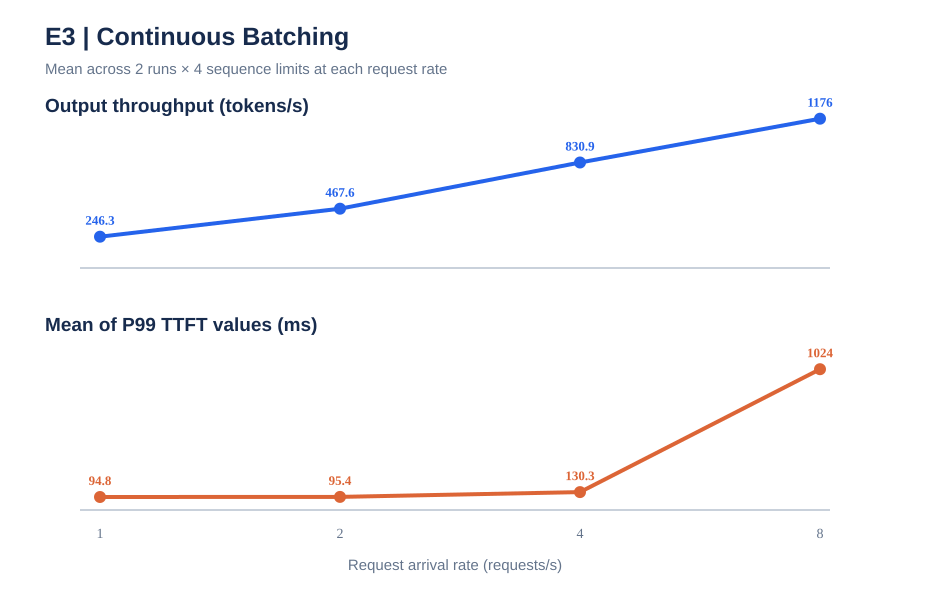
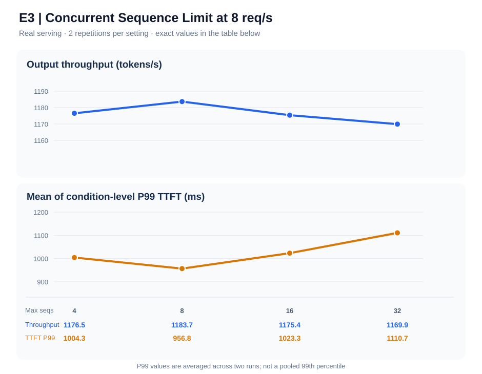
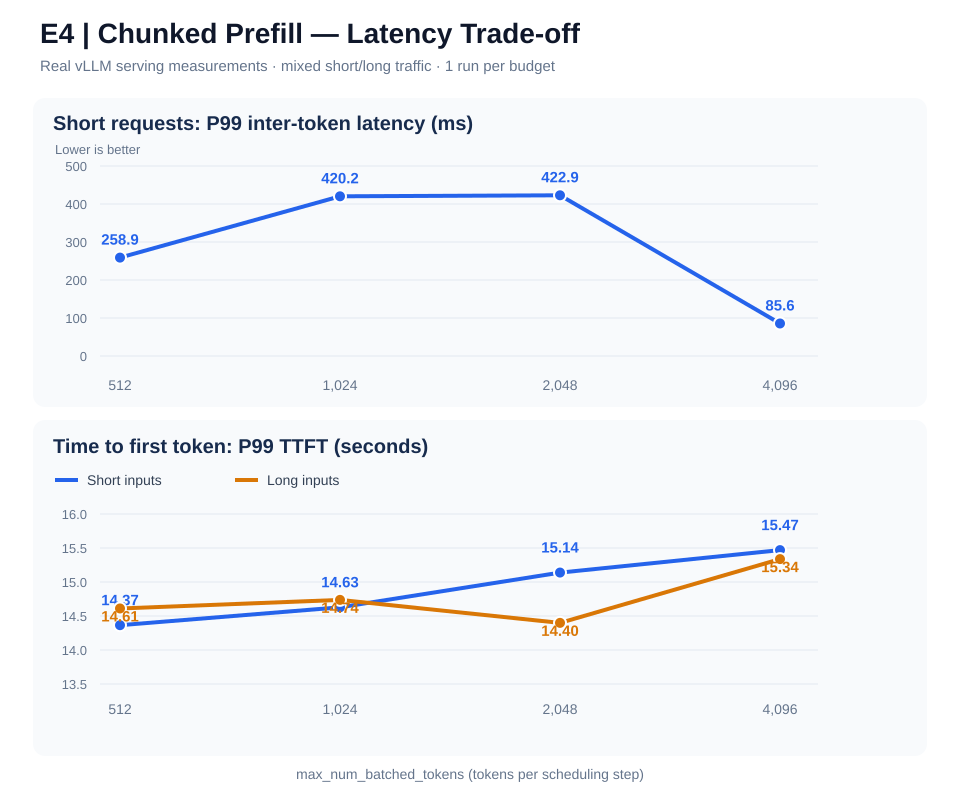

# PagedAttention & LLM Serving Optimization

Five connected experiments on KV memory management, concurrency, scheduling, and serving performance.

## Experimental roadmap

| Experiment | Focus | Status |
|---|---|---|
| **E1 — Block Size & Memory Efficiency** | KV allocation, token-slot fragmentation, CUDA tensor allocation | **CPU + CUDA allocation runs reported (2026-11-23)** |
| **E2 — KV Capacity & Preemption** | Real vLLM serving, KV occupancy, queueing | **Measured — [results](experiments/E2_kv_capacity_preemption/README.md)** |
| **E3 — Continuous Batching** | Request-rate/concurrency sweeps | **32 measured conditions — [results](experiments/E3_continuous_batching/README.md)** |
| **E4 — Chunked Prefill** | Mixed short-decode/long-prefill traffic, TTFT and ITL/TPOT | **4 measured conditions — [results](experiments/E4_chunked_prefill/README.md)** |
| **E5 — Prefix Caching** | Shared vs unique prefixes, cache ON/OFF, TTFT and cache hits | **Code implemented — [experiment](experiments/E5_prefix_caching/README.md)** |

## E1: KV Block Size & Memory Efficiency

**Question:** How does the KV block size affect storage fragmentation for short, long, and mixed request lengths?

### Experiment design

- Fixed request set generated with seed `1993`: **24 requests per workload**
- `short`: lengths drawn uniformly from **64–512 tokens**
- `long`: lengths drawn uniformly from **2048–4096 tokens**
- `mixed`: 12 short + 12 long requests
- Block sizes: **8, 16, 32, 64, 128** token slots
- Synthetic KV dimensions: **1 layer, 8 KV heads, head dimension 64, FP16**
- Fixed-reservation baseline: **8192 token slots per request**

All block sizes are evaluated on the **same token lengths** within each workload.

### Workload input lengths and token totals

E1 uses **synthetic request lengths, not real prompts or token IDs**. Each workload consists of 24 requests generated using Python `random.Random(1993)`.

| Workload | Requests | Tokens per request | Total used tokens |
|---|---:|---|---:|
| Short | 24 | Uniform random integer from 64 to 512 | **6,247** |
| Long | 24 | Uniform random integer from 2,048 to 4,096 | **74,999** |
| Mixed | 24 | 12 Short + 12 Long requests | **42,993** |

`mixed` is formed from `short[:12] + long[12:]`, reusing the original randomly sampled lengths. The `Total used tokens` values above are the actual sums from the E1 run and do not include block padding. These lengths are used solely to estimate/allocate KV storage; no model prefill or decode is executed.

### Formulas

```text
blocks(request) = ceil(request_tokens / block_size)
allocated_slots = sum(blocks(request)) * block_size
unused_slots = allocated_slots - sum(request_tokens)
fragmentation (%) = 100 * unused_slots / allocated_slots
KV payload (bytes) = allocated_slots * 2(K,V) * layers
                     * KV heads * head dimension * dtype bytes
```

### Run

From `03-pagedattention-memory-management/`:

```bash
# Step 1: theoretical allocator model (no GPU required)
python experiments/E1_block_size_memory/run_e1.py --device cpu

# Step 2: actual synthetic K/V tensor allocation on NVIDIA GPU
python experiments/E1_block_size_memory/run_e1.py --device cuda
```

Results are saved to:

- `results/E1_block_size_summary.csv`
- `figures/E1_block_size_fragmentation.png`

CSV includes the theoretical KV tensor payload, a fixed-capacity reservation baseline, unused slot fraction, and optional observed CUDA **allocated-memory delta**. The CUDA delta is for PyTorch's synthetic tensor allocation, **not** an end-to-end vLLM experiment.

### E1 results 

Both theoretical CPU calculation and the optional CUDA tensor allocation run were completed by the experimenter. **The table below was transcribed from two console screenshots; the original generated CSV and PNG were not uploaded.** CSV: [E1 block-size results transcribed from screenshots](results/E1_block_size_summary_from_screenshots.csv).

| Workload | Block size | Physical Blocks | Unused slots | Fragmentation | KV payload (MiB) | CUDA allocated delta (MiB) |
|---|---:|---:|---:|---:|---:|---:|
| Short | 8 | 790 | 73 | 1.16% | 12.34 | 12.34375 |
| Short | 16 | 401 | 169 | 2.63% | 12.53 | 12.53125 |
| Short | 32 | 207 | 377 | 5.69% | 12.94 | 12.9375 |
| Short | 64 | 111 | 857 | 12.06% | 13.88 | 14 |
| Short | 128 | 60 | 1433 | 18.66% | 15.00 | 16 |
| Long | 8 | 9385 | 81 | 0.11% | 146.64 | 146.640625 |
| Long | 16 | 4698 | 169 | 0.22% | 146.81 | 146.8125 |
| Long | 32 | 2354 | 329 | 0.44% | 147.12 | 147.125 |
| Long | 64 | 1181 | 585 | 0.77% | 147.62 | 148 |
| Long | 128 | 597 | 1417 | 1.85% | 149.25 | 150 |
| Mixed | 8 | 5384 | 79 | 0.18% | 84.12 | 84.125 |
| Mixed | 16 | 2698 | 175 | 0.41% | 84.31 | 84.3125 |
| Mixed | 32 | 1354 | 335 | 0.77% | 84.62 | 84.625 |
| Mixed | 64 | 681 | 591 | 1.36% | 85.12 | 86 |
| Mixed | 128 | 345 | 1167 | 2.64% | 86.25 | 86.25 |

**Metric definitions:** **KV payload (MiB)** is the theoretical memory needed for all allocated K/V token slots, including unused tail slots: `physical blocks × block size × KV bytes per token`. **CUDA allocated delta (MiB)** is the increase in PyTorch's `torch.cuda.memory_allocated()` when the corresponding synthetic FP16 K/V tensor is created on the GPU. It is not total GPU VRAM usage or model inference memory.

**Observed pattern:** in these fixed request sets, smaller blocks reduced the fraction of unused tail slots. The impact was much more pronounced for short requests (block 8: **1.16%**, block 128: **18.66%**) than long requests (**0.11%** vs **1.85%**). Block count moved in the opposite direction: e.g. mixed workload **5,384 blocks (size 8)** vs **345 blocks (size 128)**. A smaller block may therefore cost additional block management work; no speed conclusion follows from this experiment.

**CUDA allocation comparison:** For some block sizes, the measured CUDA allocated delta exceeded the calculated KV payload (e.g., short requests with block size 128: **16 MiB allocated vs 15 MiB payload**).


## E2: KV Cache Capacity & Preemption — Results

**Purpose:** Measure actual vLLM KV cache usage, request queueing, preemption, and latency as serving load increases.

The higher-load run used **96 synthetic requests** of **2,048 input + 1,024 output tokens** each (16 requests/s, `max_num_seqs=32`, GPU memory fraction 0.75).

| Key measured result | Value |
|---|---:|
| KV cache usage (mean / peak) | **8.52% / 12.06%** |
| Running / waiting requests (peak) | **32 / 75** |
| Preemptions | **0** |
| Output throughput | **695.24 tokens/s** |
| Mean / P99 TTFT | **50.76 / 100.35 seconds** |
| Mean / P99 TPOT | **42.68 / 45.67 ms** |

**Result:** The running-sequence limit was reached and requests accumulated in the waiting queue while KV cache use stayed below 13%. **No preemption occurred** in this run. The experiment therefore demonstrates queueing under the configured workload, rather than a KV-capacity exhaustion threshold.

[Full experiment objective, source-derived metrics and execution commands](experiments/E2_kv_capacity_preemption/README.md).

## E3: Continuous Batching — Results

Two 16-condition sweeps measured `max_num_seqs` (4/8/16/32) and incoming request rates (1/2/4/8 requests/s), with **48 synthetic requests per condition**.

| Arrival rate | Mean output throughput | Mean of condition-level P99 TTFT |
|---:|---:|---:|
| 1 req/s | 246.30 tokens/s | 94.77 ms |
| 2 req/s | 467.55 tokens/s | 95.35 ms |
| 4 req/s | 830.88 tokens/s | 130.28 ms |
| 8 req/s | 1,176.36 tokens/s | 1,023.75 ms |



**Observed behavior:** Increasing arrival rate from 1 to 8 req/s raised output throughput from **246.30 to 1,176.36 tokens/s**, but the sampled waiting peak changed from **0 to 4–5 requests** and the mean condition-level P99 TTFT rose to **1.02 s**. At 8 req/s, increasing `max_num_seqs` from 4 to 32 did not consistently improve throughput or first-token latency.



See [all 16 averaged settings, both graphs and detailed E3 interpretation](experiments/E3_continuous_batching/README.md).

## E4: Chunked Prefill — Results

The mixed workload used short requests (128 input / 256 output tokens) and long requests (4096 input / 128 output tokens), with chunked prefill enabled and token budgets of 512, 1024, 2048 and 4096.

| Token budget | Short P99 TTFT | Short P99 ITL | Long P99 TTFT |
|---:|---:|---:|---:|
| 512 | 14.37 s | 258.92 ms | 14.61 s |
| 1024 | 14.63 s | 420.25 ms | 14.74 s |
| 2048 | 15.14 s | 422.93 ms | 14.40 s |
| 4096 | 15.47 s | 85.57 ms | 15.34 s |



**Observed behavior:** Short P99 ITL was non-monotonic (**258.92 → 420.25 → 422.93 → 85.57 ms**), while Short P99 TTFT increased from **14.37 to 15.47 s** across the tested budgets. Running requests reached the limit of **16**, with **30–31 waiting** at peak. Results are from one run per budget; see [E4's complete measurements, graph and six detailed observations](experiments/E4_chunked_prefill/README.md).
