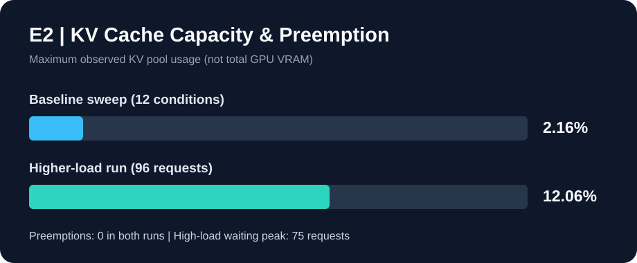

# E2 — KV Cache Capacity & Preemption

## Goal

Evaluate how KV cache usage, concurrent requests, queueing, preemption and serving throughput change under actual vLLM inference workloads.

**Model:** `Qwen/Qwen2.5-0.5B-Instruct`, FP16. The benchmark uses synthetic request tokens, not a real conversation dataset.

## Setup and selected measurements

| | Baseline sweep | Higher-load run |
|---|---|---|
| `gpu_memory_utilization` | 0.75 / 0.85 / 0.90 | 0.75 |
| `max_num_seqs` | 8 / 16 | 32 |
| Request rate | 2 / 4 req/s | 16 req/s |
| Number of requests | 48 per condition | 96 |
| Input / output | 1,024 / 256 tokens | 2,048 / 1,024 tokens |
| **Maximum observed KV pool usage** | **2.16%** (maximum across sweep) | **12.06%** |
| **Preemptions** | **0** in all 12 conditions | **0** |
| Output throughput | See examples below | **695.24 tokens/s** |
| Peak running / waiting | — | **32 / 75** |
| Mean / P99 TTFT | — | **50.76 / 100.35 s** |
| Mean / P99 TPOT | — | **42.68 / 45.67 ms** |

`—` means the metric is not provided in the screenshots for that summary. The baseline and stress workloads differ; they are **not** a controlled, single-variable comparison.

### Baseline examples: observed output throughput

| GPU memory fraction | Max sequences | Arrival rate | Output throughput |
|---|---:|---:|---:|
| 0.75 | 8 | 2 req/s | **448.83 tokens/s** |
| 0.75 | 8 | 4 req/s | **750.39 tokens/s** |

### KV usage chart



## Key findings

1. Increasing the offered load raised observed KV pool usage (baseline sweep maximum **2.16%**; high-load run **12.06%**).
2. **No preemption was observed** in either run. This experiment did not reach the intended KV cache capacity limit.
3. At high load, **32 requests were running**, **75 were waiting at peak**, and **TTFT P99 reached 100.35 s**, while KV pool usage peaked at only **12.06%**. This shows substantial queueing under the tested sequence limit and workload, rather than demonstrated KV memory exhaustion.

**Conclusion:** E2 documents actual serving behavior at two load levels. The experiment captured growing queueing and KV occupancy, but **does not establish a KV-memory-induced preemption threshold**.

## Reproduction

Implementation: [`run_e2.py`](run_e2.py). From `03-pagedattention-memory-management/`:

```bash
# Initial 12-condition sweep
python experiments/E2_kv_capacity_preemption/run_e2.py

# Higher-load run
python experiments/E2_kv_capacity_preemption/run_e2.py \
  --memory-utilizations 0.75 --max-num-seqs 32 \
  --request-rates 16 --num-prompts 96 \
  --input-len 2048 --output-len 1024 \
  --max-model-len 4096 --sample-interval 0.2
```

**Data provenance:** All numbers are from console/table screenshots supplied by the experimenter on 2026-11-23. The original runtime `summary.csv` was not uploaded to this repository. The plot depicts those observed numbers; it is not a simulated benchmark.
