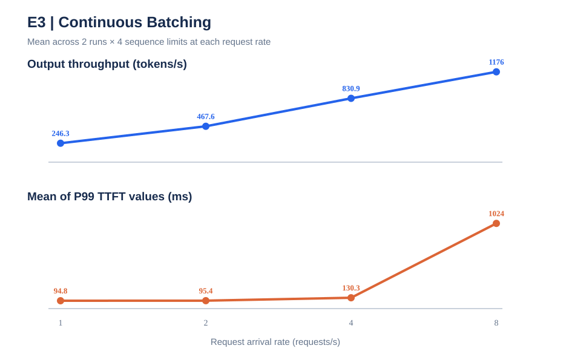
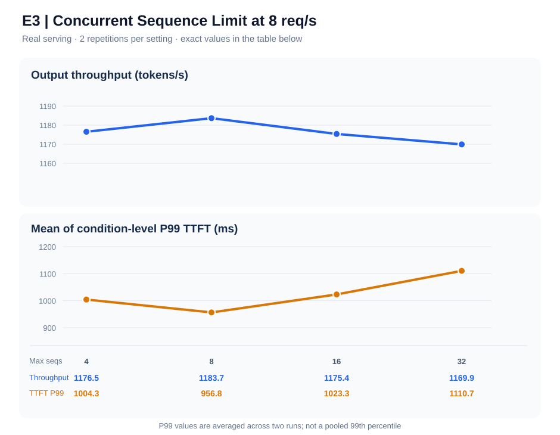

# E3 — Continuous Batching & Request Scheduling

## Objective

Measure how `max_num_seqs` and incoming request rate affect running/waiting requests, throughput and TTFT/TPOT in a real vLLM server. This is a **continuous batching workload sweep**, not a static-vs-continuous batching comparison.

## Experiment configuration

| Parameter | Setting |
|---|---|
| Model | Qwen/Qwen2.5-0.5B-Instruct, FP16 |
| GPU memory fraction | 0.80 (fixed) |
| Max model length / batch token budget | 4096 / 4096 |
| Input/output tokens per request | 1024 / 256 |
| Requests per condition | 48 |
| Seed | 1993 |
| `max_num_seqs` | **4 / 8 / 16 / 32** |
| Request arrival rate | **1 / 2 / 4 / 8 requests/s** |

Sixteen conditions; `max_num_seqs` changes restart the server. Actual measured throughput, queue length and latency are reported in timestamped CSV files. GPU metrics are sampled via `/metrics`.

## Commands

From `03-pagedattention-memory-management/`:

```bash
# Smoke test
python experiments/E3_continuous_batching/run_e3.py --max-num-seqs 8 --request-rates 2 --num-prompts 12

# Full sweep
python experiments/E3_continuous_batching/run_e3.py
```

## Results — two complete sweeps (2026-11-23)

Two complete runs of the 16-condition matrix produced **32 real serving measurements**. The same synthetic request lengths, GPU-memory fraction and generation settings were held fixed while sweeping two independent variables: `max_num_seqs` and request arrival rate. All tables below use the **arithmetic mean of the two runs** for each condition.

### A. Arrival rate: throughput and first-token delay

The following table additionally averages across the four tested `max_num_seqs` settings at each arrival rate.

| Offered load | Output throughput | Mean of P99 TTFT | Observed waiting peak |
|---:|---:|---:|---|
| 1 req/s | **246.30 tokens/s** | **94.77 ms** | 0 |
| 2 req/s | **467.55 tokens/s** | **95.35 ms** | 0 |
| 4 req/s | **830.88 tokens/s** | **130.28 ms** | 0 |
| 8 req/s | **1,176.36 tokens/s** | **1,023.75 ms** | 4–5 |



**Observation A1 — Throughput rises as the server receives more work.** Between 1 and 8 requests/s, average measured output throughput increased from **246.30 to 1,176.36 tokens/s** (about **4.78×**). This is not a 4.78× algorithmic speedup: the server was offered more requests per second.

**Observation A2 — High request rate introduces queueing and a tail-latency jump.** The sampled waiting peak was **zero** for every condition at 1, 2 and 4 req/s, but **4–5 waiting requests** were observed at 8 req/s. The average condition-level P99 TTFT grew from **130.28 ms (4 req/s)** to **1,023.75 ms (8 req/s)**, nearly **7.86×**. This is an observed high-load response-delay effect, not proof of the exact saturation threshold.

### B. Sequence limit: compare at the *same* 8 req/s load

| `max_num_seqs` | Output throughput | Mean of P99 TTFT | Waiting peak, run 1 / 2 |
|---:|---:|---:|---|
| 4 | 1,176.54 tokens/s | 1,004.27 ms | 4 / 5 |
| 8 | **1,183.65 tokens/s** | **956.78 ms** | 5 / 4 |
| 16 | 1,175.37 tokens/s | 1,023.27 ms | 5 / 5 |
| 32 | 1,169.90 tokens/s | 1,110.68 ms | 5 / 5 |



**Observation B1 — A larger limit did not consistently improve throughput.** At 8 req/s, average throughput ranged from **1,169.90 to 1,183.65 tokens/s** across the four sequence limits (about **1.2%** relative spread). Raising the upper limit from 4 to 32 did not produce a monotonic gain.

**Observation B2 — A larger limit did not consistently reduce P99 TTFT either.** The 8-sequence setting had the lowest observed average P99 TTFT (**956.78 ms**), whereas the 32-sequence setting had the highest (**1,110.68 ms**). Only two repetitions were conducted, so these are observations rather than a demonstrated globally optimal setting.

### C. All 16 settings — average values from the two runs

| Max sequences | Arrival rate | Output TPS | Mean of P99 TTFT (ms) |
|---:|---:|---:|---:|
| 4 | 1 | 246.31 | 110.30 |
| 4 | 2 | 467.24 | 99.83 |
| 4 | 4 | 832.69 | 129.55 |
| 4 | 8 | 1,176.54 | 1,004.27 |
| 8 | 1 | 246.27 | 88.63 |
| 8 | 2 | 467.49 | 110.23 |
| 8 | 4 | 831.00 | 123.45 |
| 8 | 8 | 1,183.65 | 956.78 |
| 16 | 1 | 246.30 | 91.24 |
| 16 | 2 | 467.72 | 87.07 |
| 16 | 4 | 830.41 | 117.82 |
| 16 | 8 | 1,175.37 | 1,023.27 |
| 32 | 1 | 246.32 | 88.90 |
| 32 | 2 | 467.76 | 84.27 |
| 32 | 4 | 829.42 | 150.31 |
| 32 | 8 | 1,169.90 | 1,110.68 |

### Research interpretation

The experiments show two different effects:

1. **Request arrival rate was the dominant factor in observed output throughput and tail delay within the tested range.** More incoming work increased GPU output utilization, but at 8 req/s the server also accumulated waiting requests and experienced markedly higher P99 TTFT.
2. **Increasing `max_num_seqs` alone did not resolve the high-load delay.** A configuration limit defines how many sequences may be scheduled, but increasing it does not itself provide additional GPU compute capacity.

**Scope:** This is an assessment of **vLLM continuous batching settings**, not a static-vs-continuous batching comparison. The P99 TTFT values in these tables are **means of individual condition-level P99 estimates**, *not* a pooled P99 across all individual requests. Waiting peaks are based on periodic metric sampling. No statistically reliable choice of an optimal `max_num_seqs` is established by two runs.

**Raw values:** [32 screenshot-transcribed records](../../results/E3_continuous_batching_summary_from_console.csv), run IDs `20261123T072647Z` and `20261123T074313Z`. The original runtime `summary.csv` files were not uploaded to GitHub.

## Recorded output

`results/E3_continuous_batching/<timestamp>/summary.csv` includes output throughput, request throughput, running/waiting peak/mean, mean/P50/P99 TTFT and TPOT, and auxiliary KV cache usage.

Per-condition folders contain `benchmark.json`, `benchmark.log` and `metrics_timeseries.csv`. The tables above report the actual console results.

## Interpretation

- At a fixed arrival rate, compare different `max_num_seqs` for changes in queueing, TTFT and throughput.
- At a fixed `max_num_seqs`, compare arrival rates to detect saturation.
- Treat KV occupancy as a check that memory pressure is not mistaken for a scheduling limitation.
- Timing and outputs depend on the particular vLLM version, GPU, and workload.

**Status:** Two complete 16-condition sweeps executed (32 measurements, 2026-11-23).
