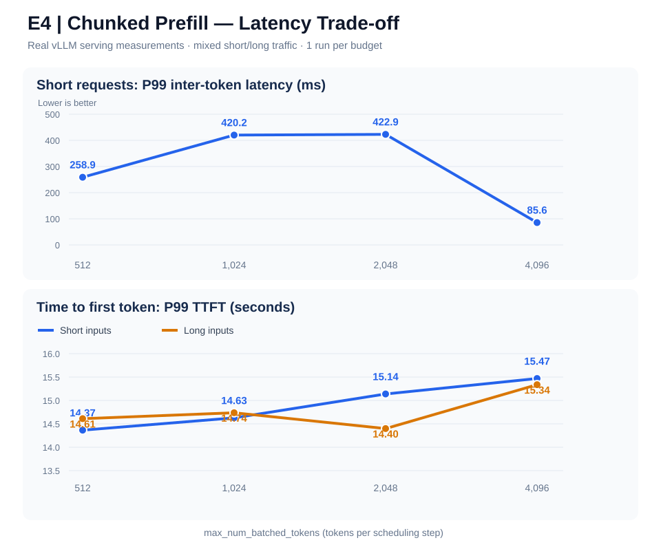

# E4 — Chunked Prefill & Latency Trade-off

## Objective

Measure how the **per-iteration token budget** (`max_num_batched_tokens`) affects **decode-side latency (ITL/TPOT)** and **prefill-side latency (TTFT)** when short, output-heavy requests run together with long-input requests on an actual vLLM server.

This is an operational serving experiment, not a simulated scheduler.

## Experimental design

| Setting | Value |
|---|---|
| Model | `Qwen/Qwen2.5-0.5B-Instruct` (FP16) |
| `enable_chunked_prefill` | Enabled |
| `max_num_batched_tokens` | **512 / 1024 / 2048 / 4096** |
| `max_num_seqs` | **16** (fixed) |
| GPU memory fraction | **0.80** (fixed) |
| Short / decode-focused traffic | **48 requests, input 128 / output 256 tokens, 4 req/s** |
| Long / prefill-focused traffic | **12 requests, input 4096 / output 128 tokens, 2 req/s** |
| Arrival arrangement | Start short-client benchmark; start long-client benchmark **2 seconds later** |
| Seed | **1993** |
| Max model length | **6144** |

Two independent benchmark client processes send requests **to the same live vLLM server**. The server is restarted for every token budget. The script stores the start/end timestamps of both clients; process overlap alone does not establish that long-prefill and short-decode GPU operations overlapped.

## Run

From `03-pagedattention-memory-management/` in the GPU runtime:

```bash
# First, one-budget smoke test
python experiments/E4_chunked_prefill/run_e4.py \
  --budgets 1024 --short-requests 12 --long-requests 4

# Full four-budget sweep
python experiments/E4_chunked_prefill/run_e4.py
```

## Measurements

| Metric | Purpose |
|---|---|
| Short-request P99 ITL | Gaps between streamed generated tokens (if benchmark version exposes it) |
| Short-request P99 TPOT | Decode-side generation delay |
| Short-request P99 TTFT | First-token delay for chat-like requests |
| Long-request P99 TTFT | First-token delay for long-prefill requests |
| Short/long output throughput | Output tokens per second for each client process |
| Peak running/waiting requests | Scheduling pressure in the mixed workload |
| KV cache peak usage | Memory-pressure diagnostic |
| Client process overlap seconds | Timing sanity check, **not** proof of GPU prefill/decode overlap |

Outputs: `results/E4_chunked_prefill/<UTC timestamp>/summary.csv`, per-budget `server.log`, `short.log`, `long.log`, `short.json`, `long.json`, `metrics_timeseries.csv`, and `timing.json`.

## Actual E4 results — 2026-11-23

The following is transcribed from the experimenter's displayed `summary.csv` dataframe. Each budget was measured once, using the mixed short/long workload specified above.

| Token budget | Short P99 TTFT (ms) | Short P99 TPOT (ms) | Short P99 ITL (ms) | Long P99 TTFT (ms) | Short output TPS | Running peak | Waiting peak | Client overlap (s) |
|---:|---:|---:|---:|---:|---:|---:|---:|---:|
| 512 | 14365.043309 | 45.439930 | 258.920732 | 14610.874356 | 441.439003 | 16 | 31 | 51.951 |
| 1024 | 14628.401160 | 47.311765 | 420.245888 | 14737.217676 | 438.748932 | 16 | 30 | 52.368 |
| 2048 | 15138.918402 | 51.914521 | 422.933350 | 14398.970268 | 422.023377 | 16 | 30 | 52.832 |
| 4096 | 15469.061988 | 50.641165 | 85.567313 | 15336.681276 | 426.469059 | 16 | 31 | 54.120 |



### Detailed observations

**Observation 1 — Short-request TTFT changed gradually with token budget.** P99 TTFT increased from **14.37 s (budget 512)** to **15.47 s (budget 4096)**, a difference of **1.10 s**, or about **7.7%** relative to the 512 setting. This measurement does not show improved first-token latency for short requests at larger budgets.

**Observation 2 — Decode-side P99 ITL was distinctly non-monotonic.** The four measured values were **258.92 → 420.25 → 422.93 → 85.57 ms** as the budget increased. Budget 4096 had the lowest observed P99 ITL, about **4.94× lower** than budget 2048. However, this is only one run per setting. ITL captures the tail of individual token gaps; TPOT averages token-generation time over a request and therefore need not track ITL spikes.

**Observation 3 — Short-request P99 TPOT changed much less dramatically than ITL.** TPOT values were **45.44, 47.31, 51.91 and 50.64 ms**, respectively. A sharp ITL reduction at budget 4096 was **not accompanied by an equally sharp TPOT reduction**. This distinction matters for streaming: rare longer pauses may change even when average output-generation speed stays similar.

**Observation 4 — Long-request TTFT did not improve consistently with larger prefill budgets.** The lowest observed long P99 TTFT was **14.40 s at budget 2048**, whereas the highest was **15.34 s at 4096**. Thus this run does not support a simple rule that increasing the token budget always accelerates long-prefill first-token delivery.

**Observation 5 — Scheduling pressure existed at every budget.** In every setting, `running_peak` reached **16** (the configured `max_num_seqs`), and `waiting_peak` was **30–31**. Consequently, the roughly **14–15 s TTFT** measurements include substantial shared-server load effects; a clean, isolated Prefill-vs-Decode interference measurement would require closer timing instrumentation.

**Observation 6 — Output throughput and client overlap.** Short-client output throughput declined from **441.44 tokens/s (512)** to **426.47 tokens/s (4096)**, with a lower measured value of **422.02 tokens/s** at 2048. The two client processes overlapped for **51.95–54.12 s**. Their time overlap confirms simultaneous client workloads but does not by itself prove that specific Prefill/Decode operations were concurrent inside a GPU kernel.

### Overall assessment

**What was measured:** all four token budgets successfully served mixed short/long synthetic workloads, with actual TTFT, TPOT, ITL, throughput, running/waiting counters and client overlap.

**What the measurements show:** changing `max_num_batched_tokens` changed the observed response metrics, but **neither P99 ITL nor long-request P99 TTFT followed a consistent monotonic pattern**. No single setting was best across every metric.

**Conclusion:** For this particular traffic mix, choosing Chunked Prefill's token budget requires considering the **tail of inter-token delay, first-token delay and throughput together**. One run per budget does not establish a stable performance ranking, nor a causal explanation for the notably low P99 ITL at 4096.

## How to interpret

- **Larger token budget:** may allow larger prefill chunks and improve long-request TTFT, at the possible expense of decode-side latency.
- **Smaller token budget:** may reduce individual iteration occupancy but increase scheduling overhead and the number of chunks needed.
- **Measured outcome is workload-specific.** A smaller model, low overlap or limited long-prefill traffic may give little observable difference.
- If `p99_itl_ms` is blank, the installed benchmark did not supply that field. Do not substitute TPOT and call it ITL.
- Short- and long-client throughput values are measured over each client's own benchmark duration; **do not sum them and claim combined server throughput**.
- The table above contains results transcribed from the provided benchmark output; raw runtime files are not included here.

**Status:** Four token-budget conditions completed; measured results documented.
