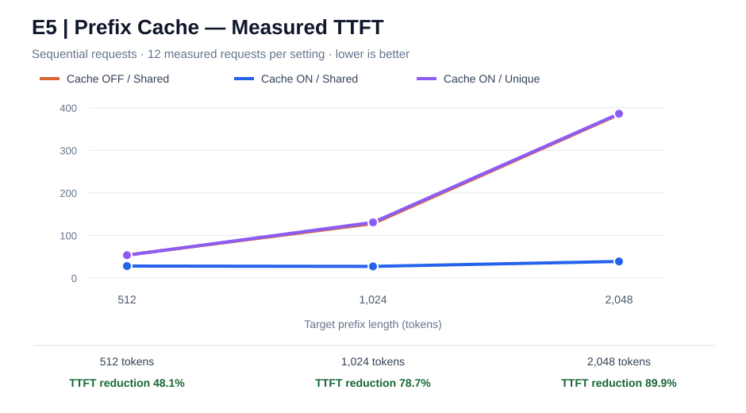

# E5 — Prefix Caching & Serving Optimization

## Goal

Measure whether vLLM **Automatic Prefix Caching (APC)** reuses previously computed KV cache when several requests have **the same token prefix**, and how that affects **time to first token (TTFT), end-to-end latency, and output throughput**.

This is a real model-serving experiment, not a synthetic allocator calculation. The benchmark sends actual streamed requests to a local vLLM server.

## Controlled experimental design

A **2 × 2 × 3** design: cache ON/OFF × shared/unique prefix × prefix lengths 512/1024/2048 tokens.

| Variable | Settings |
|---|---|
| Model | `Qwen/Qwen2.5-0.5B-Instruct`, FP16 |
| Automatic Prefix Caching | **OFF / ON** (explicit server setting) |
| Prefix pattern | **Shared** (same beginning + different suffix) / **Unique** (different beginning per request) |
| Target prefix lengths | **512 / 1024 / 2048** tokenizer tokens |
| Number of measured requests | **12 per cell** (plus one unmeasured warm-up request) |
| Output length | **64 tokens** (`ignore_eos=True`) |
| Request arrival | **Sequential**, one at a time |
| GPU memory fraction | **0.80** |
| Max model length | **4096** |
| Max concurrently scheduled sequences | **8** |

The server restarts for each (cache setting, prefix length) combination; within a server, the unique workload is measured **first**, then the shared workload. This reduces cross-cell cache contamination. The shared workload reuses identical prefix text but a different question suffix. Unique workloads change the **beginning** of the prompt so they cannot reuse a long shared prefix.

The script builds the prefix using the actual Hugging Face tokenizer, saves the **actual prompt token length range**, and checks the server's supported CLI form for disabling prefix caching.

## Metrics

| Output column | Interpretation |
|---|---|
| `ttft_mean_ms`, `ttft_p50_ms`, `ttft_p99_ms` | Actual client-measured first streamed text latency |
| `e2e_mean_ms` | Mean request duration until streaming completes |
| `measured_output_throughput_tps` | Output tokens per second during measured sequential requests, using API-reported completion token counts |
| `prefix_queries_delta` | Increase in prefix-cache query tokens reported by vLLM |
| `prefix_hits_delta` | Increase in prefix-cache hit tokens reported by vLLM |
| `prefix_hit_ratio` | `prefix_hits_delta / prefix_queries_delta` when both are available |
| `kv_usage_after` | KV pool occupancy at the end of that workload |

A **cache-hit counter** measures the engine's observed prefix reuse. The ratio is based on **token queries/hits**, not the percentage of requests with any cache hit. In versions that do not expose a metric, the field remains blank rather than being treated as zero.

TTFT here is measured by the client from issuing an HTTP request until the first nonempty streamed text. It includes network loopback and API overhead, not solely the GPU prefill kernel time.

## Run

From `03-pagedattention-memory-management/`:

```bash
# Smoke test: two prefix patterns, ON/OFF for 512 tokens
python experiments/E5_prefix_caching/run_e5.py \
  --prefix-lengths 512 --requests 4

# Full: 3 prefix lengths x 2 cache states x 2 workload patterns
python experiments/E5_prefix_caching/run_e5.py \
  --prefix-lengths 512 1024 2048 --requests 12 \
  --output-tokens 64 --gpu-memory-utilization 0.80
```

## E5 measured results — 2026-11-24

All **12 conditions** completed (3 target prefix lengths × cache ON/OFF × Shared/Unique). Each condition has **12 measured sequential requests** following one warm-up request.

### Mean TTFT and Cache Hit Ratio

| Prefix | Cache OFF / Unique | Cache OFF / Shared | Cache ON / Unique | Cache ON / Shared | Cache ON / Shared hit ratio |
|---:|---:|---:|---:|---:|---:|
| 512 tokens | 52.5 ms | **53.9 ms** | 53.5 ms | **28.0 ms** | 97.52% |
| 1,024 tokens | 128.3 ms | **127.9 ms** | 130.6 ms | **27.3 ms** | 98.65% |
| 2,048 tokens | 384.8 ms | **384.6 ms** | 386.0 ms | **38.9 ms** | 99.32% |

In **Cache ON / Unique**, the observed hit ratio was **0.00%** at all three lengths. When caching was OFF, the hit-ratio metric was unavailable (shown as `None` in the console), not 0%.



### Shared-prefix comparison: response and output throughput

| Shared prefix | Cache OFF mean TTFT | Cache ON mean TTFT | Relative TTFT reduction | TTFT speedup | Output TPS OFF → ON |
|---:|---:|---:|---:|---:|---:|
| 512 | 53.9 ms | 28.0 ms | **48.1%** | **1.93×** | 151.71 → 162.21 |
| 1,024 | 127.9 ms | 27.3 ms | **78.7%** | **4.68×** | 125.26 → 156.32 |
| 2,048 | 384.6 ms | 38.9 ms | **89.9%** | **9.89×** | 80.47 → 142.34 |

**Observation 1 — Cache reuse was measured directly.** With caching ON, Shared requests reported a **97.52–99.32% token-level hit ratio**, while Unique requests reported **0%**. This supports that reusing the same token prefix, not merely enabling the cache flag, drove the large TTFT differences.

**Observation 2 — Prefill cost increases without reuse.** For Shared requests with caching OFF, mean TTFT increased from **53.9 ms (512)** to **384.6 ms (2048)**. With caching ON, mean TTFT stayed in the **27.3–38.9 ms** range over those lengths.

**Observation 3 — Larger shared prefixes showed greater relative TTFT savings.** OFF→ON reductions were **48.1%, 78.7%, 89.9%** for 512, 1024 and 2048 tokens. The largest setting had about a **9.89× TTFT speedup**.

**Observation 4 — The Unique control stayed near the uncached baseline.** Cache ON / Unique TTFT was **53.5, 130.6 and 386.0 ms**, closely matching Cache OFF / Unique **52.5, 128.3 and 384.8 ms**. Simply enabling caching did not meaningfully reduce first-token latency when there was no reusable shared prefix.

**Observation 5 — Output throughput improved in this sequential-request setup.** For Shared prompts, the measured client-side output tokens/s increased from **151.71→162.21**, **125.26→156.32**, and **80.47→142.34**, respectively. These are sequential benchmark throughputs, **not** peak throughput under concurrent production traffic.

**Conclusion:** In this workload, actual KV prefix reuse was accompanied by substantial reductions in first-token latency. The effect grew with the reused prefix length, and the Unique-prefix control did not show the same benefit. This is evidence for **Automatic Prefix Caching** in the tested serving setup; it does not establish the same numerical improvement for unrelated models, GPUs, or concurrent traffic.

**Source:** [Twelve console-transcribed E5 measurements](../../results/E5_prefix_caching_summary_from_console.csv) from run `20261124T061331Z`. Detailed per-request TTFTs were printed in the console, while the original runtime CSV was not supplied to GitHub.

## Analysis plan

1. Compare **cache OFF + shared prefix** against **cache ON + shared prefix** at the same length to estimate the impact of caching.
2. Compare **cache ON + shared** vs **cache ON + unique** to check whether actual reusable content, not the ON flag alone, drives the difference.
3. Check `prefix_hits_delta` and `prefix_hit_ratio` alongside latency. A speed difference without cache hits is not evidence of KV reuse.
4. Assess how the benefit changes as shared prefixes lengthen from 512 to 2048 tokens.
5. Report the actual measured prompt lengths and note that sequential requests evaluate *reuse between requests*, not throughput under high concurrency.

## Output files

```text
results/E5_prefix_caching/<UTC_timestamp>/
├── configuration.json
├── summary.csv
└── prefix_<N>_cache_on_or_off/
    ├── server.log
    ├── unique_requests.csv
    └── shared_requests.csv
```

**Status:** Full 12-condition benchmark completed; actual values, plot and conclusions recorded.

## Reference

- [vLLM Automatic Prefix Caching](https://docs.vllm.ai/en/stable/features/automatic_prefix_caching/)
- [vLLM serving CLI](https://docs.vllm.ai/en/stable/cli/serve/)
- [vLLM metrics (prefix cache queries/hits)](https://docs.vllm.ai/en/stable/design/metrics/)
